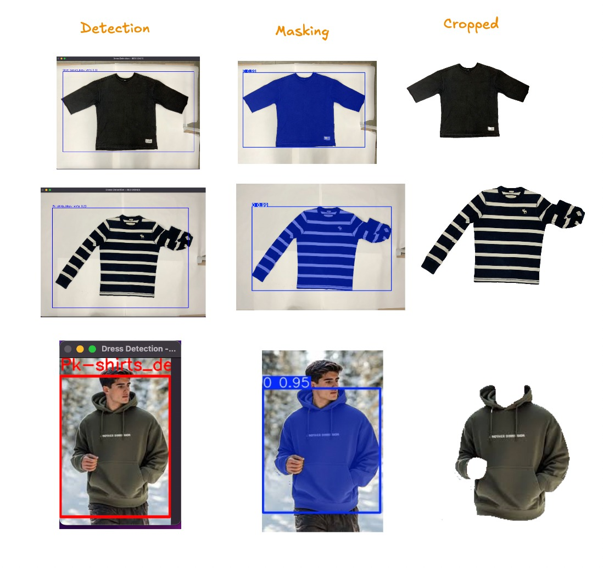

# MECO - Measurement Co-Pilot for Garments

MECO is an AI-powered measurement tool for the garment industry that automates precise clothing measurements using state-of-the-art computer vision.

## How It Works

1. **Garment Detection**
   YOLOv11n model (custom-trained for 100 epochs in Google Colab) identifies clothing items and bounding boxes with high accuracy on shirts, pants, dresses, and more.

2. **Precise Segmentation**
   SAM2 Large (sam2_l.pt) generates pixel-perfect masks from YOLO detections, isolating garment edges for accurate contour analysis.

3. **Landmark Detection & Measurements**
   Extracts key garment landmarks (shoulders, waist, hem) from segmented masks to compute industry-standard measurements.

## Quick start

### Environment and Project setup

```bash
# Set up environment
uv venv --python 3.11

# Activate environment
source .venv/bin/activate

# Install required packages
uv pip install -r requirements.txt

# Download the AI models
mkdir -p models/

gdown 1ynYgxmA-ozlLg6veS29aeJjfTI-Ua2n2 -O models/yolo11n-dress.pt

gdown 14F6S34Roh1c6F9-SsENTUT9wS_cEGHpf -O models/yolo11n-coin.pt

gdown 15td78S8cXR_Lp76vJyFmL2Nvx7jzbEVM -O models/sam2_l.pt
```

**note:**
You can also manually download models from: [Google Drive Folder](https://drive.google.com/drive/folders/1N7v2W0yjePEF206Aj8gY5t2EKTSfSmG6?usp=sharing)  
Place `.pt` files in `models/` folder.

#### Run

```bash
# Run on sample garment
python main.py --image data/images/222.jpg

# Or just run with default image
python main.py
```

## Sample outputs


